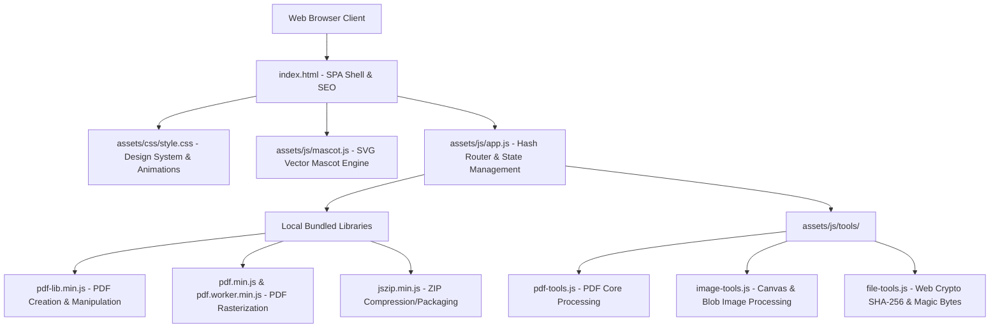
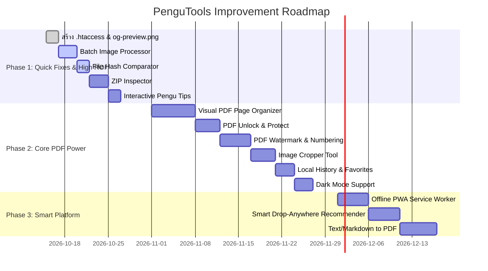

# 🐧 PenguTools — รายงานการวิเคราะห์ระบบและแผนการพัฒนาฟีเจอร์ (Project Improvement Roadmap)

> **เอกสารวิเคราะห์ทางเทคนิคและแผนยุทธศาสตร์การพัฒนาเว็บแอปพลิเคชัน PenguTools**  
> *สถานะโครงการ:* v1.0 Production Readiness & Feature Expansion Roadmap  
> *สถาปัตยกรรมหลัก:* 100% Client-Side In-Browser Processing (Vanilla JavaScript, HTML5 Canvas, Web Crypto, WebAssembly)  
> *เป้าหมายการติดตั้ง:* Apache / Nginx / LiteSpeed Shared Hosting (`public_html`) และ Subdirectory Deployment  

---

## สารบัญ

1. [บทนำและภาพรวมโปรเจกต์ปัจจุบัน](#1-บทนำและภาพรวมโปรเจกต์ปัจจุบัน)
2. [โครงสร้างระบบและเทคโนโลยีที่ใช้งาน](#2-โครงสร้างระบบและเทคโนโลยีที่ใช้งาน)
3. [การวิเคราะห์ปัญหาและข้อจำกัดทางเทคนิคที่ตรวจพบ](#3-การวิเคราะห์ปัญหาและข้อจำกัดทางเทคนิคที่ตรวจพบ)
4. [ข้อเสนอแนะฟีเจอร์และระบบใหม่ พร้อมการประเมินความเป็นไปได้ 11 มิติ](#4-ข้อเสนอแนะฟีเจอร์และระบบใหม่-พร้อมการประเมินความเป็นไปได้-11-มิติ)
5. [ตารางเปรียบเทียบความสำคัญและความยากในการพัฒนา (Priority Matrix)](#5-ตารางเปรียบเทียบความสำคัญและความยากในการพัฒนา-priority-matrix)
6. [การวิเคราะห์และข้อเสนอแนะเชิงลึกด้าน UI/UX, Security, Performance และ Accessibility](#6-การวิเคราะห์และข้อเสนอแนะเชิงลึกด้าน-uiux-security-performance-และ-accessibility)
7. [แผนงานการพัฒนา (Roadmap): ระยะสั้น ระยะกลาง และระยะยาว](#7-แผนงานการพัฒนา-roadmap-ระยะสั้น-ระยะกลาง-และระยะยาว)
8. [การจัดการ Dependencies และข้อกำหนดสำหรับ Shared Hosting](#8-การจัดการ-dependencies-และข้อกำหนดสำหรับ-shared-hosting)
9. [การบริหารความเสี่ยงและแนวทางการทดสอบระบบ (Testing Strategies)](#9-การบริหารความเสี่ยงและแนวทางการทดสอบระบบ-testing-strategies)
10. [สรุปข้อเสนอแนะและลำดับก้าวแรกที่ควรเริ่มพัฒนา](#10-สรุปข้อเสนอแนะและลำดับก้าวแรกที่ควรเริ่มพัฒนา)

---

## 1. บทนำและภาพรวมโปรเจกต์ปัจจุบัน

### 1.1 วัตถุประสงค์และจุดยืนของเว็บไซต์ (Product Positioning)
**PenguTools** ถูกวางตำแหน่งเป็น **"Cute Online File Toolkit"** ภายใต้สโลแกน *"Small Penguin, Big File Solutions!"* โดยเน้นความเรียบง่าย สบายตา สไตล์ **Cute Minimal SaaS** ผสมผสานกับ **Soft UI** (โทนสีฟ้า-ขาว `#0284c7` และ `#f0f9ff`) จุดเด่นที่มีมูลค่าสูงสุดคือ **"100% Client-Side In-Browser Processing"** ซึ่งประมวลผลไฟล์ทั้งหมดบน RAM ของเครื่องผู้ใช้งานโดยตรง ไม่มีการอัปโหลดไฟล์ไปยังเซิร์ฟเวอร์ใด ๆ ทั้งสิ้น จึงตอบโจทย์ด้านความเป็นส่วนตัว (Privacy & Confidentiality) สูงสุด

### 1.2 สรุปเครื่องมือและฟังก์ชันที่มีอยู่ในปัจจุบัน (10 เครื่องมือหลัก)
จากการตรวจสอบโค้ดใน [app.js](file:///d:/workk/2569_1/aekapop/project/pdf_tool/assets/js/app.js) และโมดูลย่อยใน `assets/js/tools/` พบว่ามีเครื่องมือที่ลงทะเบียนใช้งานจริงดังนี้:

| หมวดหมู่ | รหัสเครื่องมือ | ชื่อเครื่องมือ | รายละเอียดการทำงานปัจจุบัน |
| :--- | :--- | :--- | :--- |
| **PDF Tools** | `merge-pdf` | รวมไฟล์ PDF | รวมไฟล์ PDF หลายไฟล์ (2-30 ไฟล์) รองรับการสลับลำดับขึ้น-ลง และลบไฟล์ |
| | `split-pdf` | แยกไฟล์ PDF | แยกตามช่วงหน้า (เช่น `1-3, 5`) เป็นไฟล์ใหม่ หรือแยกทุกหน้าเป็นไฟล์เดี่ยวใน ZIP |
| | `compress-pdf` | บีบอัด PDF | 2 โหมด: Visual Downsampling (เรนเดอร์หน้าเป็น JPEG) และ Structural (รวม Object Streams) |
| | `rotate-pdf` | หมุนหน้ากระดาษ PDF | หมุน 90°, 180°, 270° เลือกหมุนทุกหน้า, หน้าคี่, หน้าคู่ หรือระบุหน้าเอง |
| | `extract-pdf` | ดึงหน้า PDF ที่เลือก | สกัดเฉพาะหน้าที่กำหนดออกมาเป็นเอกสาร PDF ใหม่ |
| | `images-to-pdf` | แปลงรูปภาพเป็น PDF | รวมไฟล์ภาพ (JPG, PNG, WebP) เป็น PDF กำหนดขนาดกระดาษ (A4/Fit) แนววาง และขอบ |
| | `pdf-to-images` | แปลง PDF เป็นรูปภาพ | แปลงหน้า PDF เป็นภาพ PNG หรือ JPG ปรับสเกลความละเอียด (1.5x, 2.0x, 3.0x) โหลดเป็น ZIP |
| **Image Tools** | `image-compressor` | บีบอัดรูปภาพ | ปรับคุณภาพ 10-95%, เลือกสเกล (100%, 75%, 50%, FHD, HD) รองรับ JPG, PNG, WebP |
| | `image-resizer` | ปรับขนาดภาพ | ปรับกว้าง-สูง (px), ล็อก Aspect Ratio, Presets ยอดนิยม (FHD, HD, Square, Avatar) |
| | `image-converter` | แปลงนามสกุลภาพ | แปลงไป-มาระหว่าง PNG, JPG, WebP พร้อมสไลเดอร์ปรับคุณภาพ |
| **File Utilities** | `file-size-checker` | ตรวจสอบขนาดไฟล์ | แสดงหน่วย Bytes, KB, MB, GB, ตรวจสอบลิมิตอีเมล 25MB, ประมาณเวลาโหลด 4G/5G/Fiber/USB |
| | `zip-files` | รวมไฟล์เป็น ZIP | รวบรวมหลายไฟล์เข้า ZIP พร้อมตั้งชื่อไฟล์และคำนวณขนาดที่ประหยัดได้ |
| | `file-info` | ดูข้อมูลไฟล์เชิงลึก | อ่าน Magic Bytes Signature (Header), คำนวณ SHA-256 Checksum, ดึงพิกเซลภาพหรือหน้า PDF |

---

## 2. โครงสร้างระบบและเทคโนโลยีที่ใช้งาน

### 2.1 แผนผังโครงสร้างซอร์สโค้ด (Architecture Diagram)



### 2.2 เทคโนโลยีและไลบรารีที่เลือกใช้
1. **Frontend Core:** Pure Vanilla JavaScript (ES6+), Vanilla CSS3 พร้อม Custom CSS Variables และ Semantic HTML5 ปราศจาก Dependency หนักอย่าง Node/Webpack/Vite ทำให้เบาและเปิดดูได้ทันที
2. **PDF Engine:**
   - [pdf-lib.min.js](file:///d:/workk/2569_1/aekapop/project/pdf_tool/assets/libs/pdf-lib.min.js) (ขนาด 525 KB) สำหรับการสร้าง, รวม, แยก, หมุน, ดึงหน้า และประกอบ PDF
   - [pdf.min.js](file:///d:/workk/2569_1/aekapop/project/pdf_tool/assets/libs/pdf.min.js) (ขนาด 320 KB) และ [pdf.worker.min.js](file:///d:/workk/2569_1/aekapop/project/pdf_tool/assets/libs/pdf.worker.min.js) (ขนาด 1.08 MB) สำหรับอ่าน แปลงเวกเตอร์เป็นพิกเซล (Rasterization) และเรนเดอร์ลง HTML5 Canvas
3. **Archive Engine:**
   - [jszip.min.js](file:///d:/workk/2569_1/aekapop/project/pdf_tool/assets/libs/jszip.min.js) (ขนาด 97 KB) สำหรับรวมไฟล์แยกหน้าหรือไฟล์ภาพให้อยู่ในรูป `.zip`
4. **Browser Native APIs:**
   - **HTML5 Canvas API:** ใช้งานใน `drawImage()`, `toBlob()`, `toDataURL()` สำหรับปรับขนาด บีบอัด และแปลงฟอร์แมตภาพ
   - **Web Crypto API:** ใช้งาน `window.crypto.subtle.digest('SHA-256', arrayBuffer)` ในการสร้าง Checksum แบบฮาร์ดแวร์เร่งความเร็วโดยไม่ต้องพึ่งไลบรารีภายนอก
   - **Blob & Object URL API:** จัดการ Stream ข้อมูลแบบ In-Memory ด้วย `URL.createObjectURL()` และ `URL.revokeObjectURL()`

---

## 3. การวิเคราะห์ปัญหาและข้อจำกัดทางเทคนิคที่ตรวจพบ

จากการตรวจสอบโค้ดอย่างละเอียด พบจุดบกพร่อง ข้อจำกัด และความไม่สอดคล้องระหว่างเอกสารกับโค้ดจริง ดังนี้:

### 3.1 ปัญหาความพร้อมในการติดตั้งบน `public_html` (Hosting & File Alignment)
* **การไม่ใช้งานไฟล์ `.htaccess` เพื่อความปลอดภัยของโฮสติ้ง (Zero-Server-Error Architecture):**
  * **ข้อเท็จจริง:** แม้ในฉบับร่างเดิมจะมีการกล่าวถึง `.htaccess` แต่ในการใช้งานจริงบน Shared Hosting หลายแห่ง การใส่ `.htaccess` ที่มี Directives เช่น `Header always set` หรือโมดูลที่ปิดกั้นไว้ อาจส่งผลให้เว็บเซิร์ฟเวอร์แจ้งเตือน **HTTP 500 Internal Server Error** และเปิดเว็บไม่ได้ทันที
  * **แนวทางที่ถูกต้อง:** PenguTools เลือกใช้แนวทาง **Pure Static Zero-Config Web Architecture** 100% โดยไม่พึ่งพาไฟล์ `.htaccess` ทำให้สามารถเปิดใช้งานบน Apache, LiteSpeed, Nginx, cPanel และ DirectAdmin ได้อย่างราบรื่น ไม่มีความเสี่ยงเรื่องเซิร์ฟเวอร์เปิดไม่ติด
* **ภาพ Open Graph Preview ขาดหาย (404 Not Found):**
  * **หลักฐาน:** ใน [index.html](file:///d:/workk/2569_1/aekapop/project/pdf_tool/index.html) บรรทัดที่ 18 ระบุ `<meta property="og:image" content="./assets/images/og-preview.png">`
  * **ข้อเท็จจริง:** โฟลเดอร์ `assets/images/` ไม่มีอยู่ในโปรเจกต์จริง เมื่อแชร์ลิงก์ไปยัง Facebook, LINE หรือ Twitter รูปภาพพรีวิวจะไม่แสดง

### 3.2 ข้อจำกัดทางเทคนิคในระบบบีบอัด PDF (Visual vs Structural Compression Trade-offs)
* **การสูญเสียข้อความ (Text Layer Loss) ในโหมด "บีบอัดภาพและหน้าเอกสาร":**
  * **หลักฐาน:** ใน [pdf-tools.js](file:///d:/workk/2569_1/aekapop/project/pdf_tool/assets/js/tools/pdf-tools.js) บรรทัดที่ 208-224 โค้ดใช้วิธีเรนเดอร์ PDF แต่ละหน้าด้วย Canvas ผ่าน PDF.js เป็น JPEG แล้วสร้างหน้าใหม่ใน PDF-Lib:
    ```javascript
    await page.render({ canvasContext: ctx, viewport: scaledViewport }).promise;
    const imgDataUrl = canvas.toDataURL('image/jpeg', jpegQuality);
    const imgBytes = await fetch(imgDataUrl).then(r => r.arrayBuffer());
    const embeddedImg = await newDoc.embedJpg(imgBytes);
    newPage.drawImage(embeddedImg, { ... });
    ```
  * **ผลกระทบ:** วิธีนี้ลดขนาดไฟล์รูปภาพและเอกสารสแกนได้ดีจริง (40-90%) แต่ทำให้ **ข้อความทั้งหมดกลายเป็นภาพบิตแมป** ผู้ใช้จะไม่สามารถ Drag คลุมข้อความ (Select Text), Copy ข้อความ, Search หาคำในเอกสาร หรือคลิกลิงก์ภายใน PDF ได้อีกต่อไป
  * **สิ่งที่ขาด:** ขาดคำเตือนใน UI ที่ระบุชัดเจนว่าโหมดนี้จะเปลี่ยนตัวหนังสือเป็นรูปภาพ และขาดตัวเลือกรักษาเลเยอร์ข้อความ

### 3.3 ปัญหา Memory Leak และความเสี่ยง Browser Tab Crash
* **การจัดเก็บรูปภาพใน RAM จำนวนมากโดยไม่แบ่ง Batch:**
  * **หลักฐาน:** ใน [pdf-tools.js](file:///d:/workk/2569_1/aekapop/project/pdf_tool/assets/js/tools/pdf-tools.js) บรรทัดที่ 480-503 (ฟังก์ชัน `pdfToImages`):
    ```javascript
    const imageResults = [];
    for (let idx = 0; idx < targetPages.length; idx++) {
      // เรนเดอร์ canvas ขนาด 2x-3x แล้วเก็บ blob ลงใน imageResults array
    }
    ```
  * **ผลกระทบ:** กรณีแปลง PDF ที่มีมากกว่า 50-100 หน้า ที่ความละเอียด 3.0x แต่ละภาพอาจใช้ RAM ระดับ 15-30 MB เมื่อเรนเดอร์ต่อเนื่องโดยไม่เคลียร์ Canvas หรือเคลียร์หน่วยความจำ จะทำให้เบราว์เซอร์บนมือถือ (iOS Safari ขีดจำกัด RAM ประมาณ 1 GB) เกิดอาการ WebKit Process Crash (หน้าเว็บรีเฟรชตัวเองทันที)
* **การจำกัดการทำงานของ Image Tools แบบไฟล์เดี่ยว (Single-file limitation):**
  * **หลักฐาน:** ใน [app.js](file:///d:/workk/2569_1/aekapop/project/pdf_tool/assets/js/app.js) บรรทัดที่ 341 (`image-compressor`), บรรทัดที่ 452 (`image-resizer`), บรรทัดที่ 508 (`image-converter`) ถูกตั้งค่า `multiple: false`
  * **ผลกระทบ:** ผู้ใช้ที่มีรูปภาพ 10-20 รูปที่ต้องการย่อขนาดหรือแปลงเป็น WebP ต้องทำทีละรูปซ้ำ ๆ ซึ่งไม่ตอบโจทย์การทำงานจริงในชีวิตประจำวัน

### 3.4 ข้อจำกัดด้านการจัดการ PDF ที่มีรหัสผ่าน (Encrypted PDF Handling)
* **หลักฐาน:** ใน `pdf-tools.js` บรรทัดที่ 76 มีการใส่ `{ ignoreEncryption: true }` แต่เมื่อเจอไฟล์ PDF ที่ติดรหัสผ่านเปิดอ่าน (User Password) ตัวไลบรารี `pdf-lib` จะโยนข้อผิดพลาด `PasswordIsRequiredError` ทันที และระบบจะหยุดทำงานโดยไม่มีหน้าต่างให้กรอกรหัสผ่านเพื่อปลดล็อกก่อนนำไปประมวลผล

### 3.5 ปัญหาด้าน UI/UX, Accessibility และ State Management
1. **ขาดระบบ Visual Thumbnail Preview ในการจัดเรียงหน้า:**
   * ในเครื่องมือ Split, Rotate, Extract ผู้ใช้ต้องกรอกตัวเลขหน้าเป็นข้อความ (`1-3, 5`) โดยมองไม่เห็นตัวอย่างหน้ากระดาษจริง ซึ่งเพิ่มภาระทางสมอง (Cognitive Load) และเสี่ยงต่อการกรอกหน้าผิด
2. **ขาด Persistent Preferences (ไม่มี Local Storage):**
   * การตั้งค่า เช่น ระดับการบีบอัด หรือฟอร์แมตภาพที่ใช้ประจำ จะถูกรีเซ็ตทุกครั้งที่รีเฟรชหน้าเว็บ
3. **การเข้าถึงด้วยคีย์บอร์ดใน Drag & Drop Zone ยังไม่สมบูรณ์แบบ:**
   * แม้ Dropzone จะมี `tabindex="0"` แต่ไม่มี Visual Focus Ring ที่ชัดเจนเพียงพอเมื่อใช้คีย์บอร์ด Tab เข้าไปในบางเบราว์เซอร์
4. **ขาด Dark Mode:**
   * โค้ดสีใน [style.css](file:///d:/workk/2569_1/aekapop/project/pdf_tool/assets/css/style.css) เป็น Fixed Palette โทนฟ้า-ขาว ไม่มี `prefers-color-scheme: dark` หรือปุ่มสลับธีม ทำให้ผู้ที่ทำงานเวลากลางคืนหรือสายตาล้าเกิดความเมื่อยล้าได้ง่าย

---

## 4. ข้อเสนอแนะฟีเจอร์และระบบใหม่ พร้อมการประเมินความเป็นไปได้ 11 มิติ

เพื่อยกระดับ PenguTools ให้เป็นเว็บจัดการไฟล์ที่ครบเครื่อง ใช้งานได้จริง มีเอกลักษณ์ และคงจุดเด่นด้าน Client-Side Privacy 100% จึงขอเสนอ 12 ฟีเจอร์ใหม่ที่ผ่านการคัดสรรแล้ว ดังนี้:

---

### กลุ่มที่ 1: เครื่องมือจัดการ PDF ขั้นสูง (Advanced PDF Suite)

#### ฟีเจอร์ที่ 1: Visual PDF Page Organizer & Thumbnail Reorder (จัดเรียง ลบ หมุนหน้าแบบเห็นภาพ)
1. **ชื่อและคำอธิบาย:** ระบบจัดเรียงหน้า PDF ด้วย Grid แสดงภาพขนาดย่อ (Thumbnail) ทุกหน้า สามารถลากสลับตำแหน่ง (Drag & Drop), คลิกหมุนทีละหน้า หรือคลิกถังขยะเพื่อลบหน้าออก แล้วเซฟเป็น PDF ใหม่
2. **ปัญหาของผู้ใช้:** ปัจจุบันผู้ใช้ต้องเดาหมายเลขหน้าเองผ่าน Textbox (`1-3, 5`) เสี่ยงต่อการลบหรือหมุนผิดหน้า
3. **ประโยชน์ที่คาดว่าจะได้รับ:** ผู้ใช้เห็นเนื้อหาจริงทุกหน้า มั่นใจ 100% ก่อนกดบันทึก ลดเวลาในการเปิดโปรแกรมดูเอกสารคู่ขนาน
4. **วิธีการทำงานโดยสรุป:** ใช้ `PDF.js` เรนเดอร์หน้ากระดาษขนาดย่อ (Scale 0.25-0.3) ลงบน HTML5 Canvas แสดงในการ์ด Grid จากนั้นใช้ HTML5 Drag & Drop API หรือ Pointer Events สลับลำดับ Array ของหน้า เมื่อผู้ใช้กดบันทึก จึงส่ง Index Array ไปยัง `PDF-Lib` เพื่อจัดทำเอกสารใหม่
5. **ความเชื่อมโยงกับระบบเดิม:** ใช้โมดูล `PdfTools.initPdfWorker()` และ `window.PDFLib` ที่มีอยู่แล้วในโปรเจกต์
6. **เทคโนโลยี/ไลบรารี:** `pdf.js` (มีแล้ว), `pdf-lib.js` (มีแล้ว)
7. **ความยากในการพัฒนา:** ปานกลาง (Medium)
8. **ผลกระทบด้าน Perf/Sec/Privacy:** ทำในเครื่อง 100% รวดเร็ว ปลอดภัย แต่ต้องระวังการเรนเดอร์หลายหน้า ให้ใช้ Lazy Rendering เฉพาะหน้าที่เลื่อนมาเห็น (Intersection Observer)
9. **ความเข้ากันได้กับ Shared Hosting:** เข้ากันได้ 100% (Client-Side)
10. **ข้อจำกัดและความเสี่ยง:** เอกสารที่มีเกิน 80 หน้าอาจทำให้ RAM สูง หากไม่ใช้ Lazy Rendering ของ Thumbnail
11. **เหตุผลที่ควรพัฒนา:** **ควรพัฒนาเป็นลำดับแรก (Must-have)** เพราะเป็นฟังก์ชันที่ผู้ใช้โปรแกรม PDF ทุกคนต้องการมากที่สุด

---

#### ฟีเจอร์ที่ 2: PDF Page Numbering & Watermark (ใส่เลขหน้าและลายน้ำเอกสาร)
1. **ชื่อและคำอธิบาย:** เครื่องมือเพิ่มเลขหน้า (เช่น "หน้า 1 จาก 10" หรือ "Page 1 of N") พร้อมตัวเลือกตำแหน่ง (ล่างซ้าย, ล่างกลาง, ล่างขวา) และการประทับลายน้ำข้อความ (เช่น "สำเนาถูกต้อง", "CONFIDENTIAL") พร้อมปรับมุมเอียงและความโปร่งใส
2. **ปัญหาของผู้ใช้:** งานเอกสารราชการ สมัครงาน หรือส่งงานอาจารย์มักบังคับให้มีเลขหน้า หรือต้องใส่ลายน้ำป้องกันการนำเอกสารไปใช้ซ้ำ
3. **ประโยชน์ที่คาดว่าจะได้รับ:** ใช้งานเอกสารทางการได้ทันทีโดยไม่ต้องเปิด Adobe Acrobat หรือ MS Word
4. **วิธีการทำงานโดยสรุป:** โหลดเอกสารด้วย `PDFDocument.load()` ใน `pdf-lib`, ฝัง Standard Font (`StandardFonts.Helvetica`) หรือวาด Canvas เป็นภาพโปร่งใสสำหรับภาษาไทย จากนั้นวนลูปหน้ากระดาษ ใช้ `page.drawText()` หรือ `page.drawImage()` วาดข้อความหรือลายน้ำตามพิกัดและองศาที่กำหนด
5. **ความเชื่อมโยงกับระบบเดิม:** ต่อยอดจากโครงสร้าง `PdfTools` ได้อย่างกลมกลืน
6. **เทคโนโลยี/ไลบรารี:** `pdf-lib.min.js` (มีแล้ว), ฟอนต์ภาษาไทยขนาดเล็ก (เช่น Sarabun WOFF/TTF ฝังด้วย fontkit) หรือใช้วิธีเรนเดอร์ข้อความไทยลง Canvas แปลงเป็น PNG Stamp เพื่อหลีกเลี่ยงการโหลด fontkit ขนาดใหญ่
7. **ความยากในการพัฒนา:** ปานกลาง (Medium)
8. **ผลกระทบด้าน Perf/Sec/Privacy:** ประมวลผลเร็วมาก (ไม่ถึง 1 วินาทีสำหรับไฟล์ 20 หน้า) ปลอดภัย 100%
9. **ความเข้ากันได้กับ Shared Hosting:** เข้ากันได้ 100%
10. **ข้อจำกัดและความเสี่ยง:** การรองรับตัวอักษรภาษาไทยใน `pdf-lib` จำเป็นต้องฝัง Fontkit หรือใช้ Canvas Rendering เทคนิค Canvas Stamp จึงเบาและง่ายกว่ามาก
11. **เหตุผลที่ควรพัฒนา:** **คุ้มค่าสูงมาก** เอกสารสมัครงานและสัญญาในไทยต้องการฟังก์ชันนี้สูง

---

#### ฟีเจอร์ที่ 3: PDF Password Protect & Unlock (ล็อกรหัสผ่านและปลดล็อก PDF)
1. **ชื่อและคำอธิบาย:** เครื่องมือตั้งรหัสผ่านสำหรับเปิดอ่าน PDF (Encrypt with AES) และปลดล็อกเอกสาร PDF ที่ทราบรหัสผ่านให้กลายเป็นเอกสารปกติโดยไม่ต้องใส่รหัสผ่านซ้ำอีก
2. **ปัญหาของผู้ใช้:** ใบเสร็จ ใบแจ้งหนี้ธนาคาร สลิปเงินเดือน หรือเอกสารประกัน มักถูกล็อกรหัสผ่านด้วยวันเดือนปีเกิด ทำให้ยุ่งยากเมื่อต้องส่งต่อ หรือกรณีผู้ใช้ต้องการส่งเอกสารลับที่มีรหัสผ่าน
3. **ประโยชน์ที่คาดว่าจะได้รับ:** จัดการสิทธิ์ของเอกสารส่วนบุคคลได้อย่างสะดวกและปลอดภัย
4. **วิธีการทำงานโดยสรุป:**
   - *การปลดล็อก:* รับรหัสผ่านจากผู้ใช้ -> ใช้ `PDFDocument.load(arrayBuffer, { password })` -> เมื่อถอดรหัสสำเร็จ เซฟใหม่แบบไม่มีรหัสผ่าน
   - *การตั้งรหัสผ่าน:* `pdf-lib` รองรับการเข้ารหัสเอกสาร (Encryption) หรือใช้ไลบรารีขนาดกะทัดรัด (เช่น `qpdf.js` หรือ WebAssembly build)
5. **ความเชื่อมโยงกับระบบเดิม:** ขยายขีดความสามารถของ `pdf-tools.js`
6. **เทคโนโลยี/ไลบรารี:** `pdf-lib` (สำหรับการถอดรหัสผ่าน standard permission)
7. **ความยากในการพัฒนา:** ง่ายถึงปานกลาง (Easy - Medium สำหรับการ Unlock / ปานกลางสำหรับการ Encrypt)
8. **ผลกระทบด้าน Perf/Sec/Privacy:** ความปลอดภัยสูงสุด เพราะรหัสผ่านไม่หลุดออกไปยังเซิร์ฟเวอร์
9. **ความเข้ากันได้กับ Shared Hosting:** เข้ากันได้ 100%
10. **ข้อจำกัดและความเสี่ยง:** หากไฟล์เข้ารหัสแบบ DRM หรือ Certificate ขั้นสูง อาจไม่รองรับ
11. **เหตุผลที่ควรพัฒนา:** **ควรพัฒนาส่วน Unlock ทันที** เพราะแก้ปัญหาไฟล์ติดรหัสผ่านในระบบเดิม

---

### กลุ่มที่ 2: เครื่องมือจัดการรูปภาพแบบเป็นชุด (Batch Image Suite)

#### ฟีเจอร์ที่ 4: Batch Image Processor (บีบอัด ปรับขนาด แปลงไฟล์หลายรูปพร้อมกัน)
1. **ชื่อและคำอธิบาย:** ปรับปรุงและรวมพลังของ Image Compressor, Resizer, และ Converter ให้รองรับการอัปโหลดได้พร้อมกันหลายสิบไฟล์ (Multiple Upload) ปรับค่าเพียงครั้งเดียวแล้วประมวลผลต่อเนื่อง พร้อมดาวน์โหลดเป็น `.ZIP`
2. **ปัญหาของผู้ใช้:** ปัจจุบัน Image Tools บังคับทำทีละไฟล์ ผู้ใช้ที่มีรูปถ่ายสินค้าหรือภาพกิจกรรม 30 รูปต้องเสียเวลารอทำทีละรูป
3. **ประโยชน์ที่คาดว่าจะได้รับ:** เพิ่ม Productivity มหาศาล ลดเวลาทำงานจาก 15 นาทีเหลือเพียง 30 วินาที
4. **วิธีการทำงานโดยสรุป:** ตั้งค่า `multiple: true` ใน Tool Definition -> วนลูปประมวลผลไฟล์ผ่าน `Promise` หรือ Sequential Loop พร้อมอัปเดตแถบความคืบหน้า (Progress Bar) ต่อรูป -> รวมผลลัพธ์ลงใน `JSZip`
5. **ความเชื่อมโยงกับระบบเดิม:** เรียกใช้ฟังก์ชันเดิมใน `ImageTools.compressImage()` และ `FileTools.zipFiles()`
6. **เทคโนโลยี/ไลบรารี:** Canvas API + `jszip.min.js` (มีอยู่แล้วทั้งคู่)
7. **ความยากในการพัฒนา:** ง่าย (Easy) เนื่องจากโค้ดฝั่งประมวลผลมีอยู่ครบแล้ว ขาดเพียง UI Loop
8. **ผลกระทบด้าน Perf/Sec/Privacy:** ประมวลผลแบบทีละรูปแล้วเคลียร์ Canvas ทันที ช่วยประหยัด RAM
9. **ความเข้ากันได้กับ Shared Hosting:** เข้ากันได้ 100%
10. **ข้อจำกัดและความเสี่ยง:** หากผู้ใช้อัปโหลด 100 รูปพร้อมกัน เบราว์เซอร์อาจหน่วง จึงควรจำกัดไม่เกิน 30-50 รูปต่อครั้ง
11. **เหตุผลที่ควรพัฒนา:** **คุ้มค่าต่อการพัฒนาสูงสุด (High ROI)** ลงแรงน้อยแต่ได้ประโยชน์ก้าวกระโดด

---

#### ฟีเจอร์ที่ 5: Image Cropper & Aspect Ratio Tool (ครอบตัดรูปภาพและปรับสัดส่วน)
1. **ชื่อและคำอธิบาย:** เครื่องมือครอปภาพแบบโต้ตอบ (Interactive Crop) เลื่อนและขยายกรอบตัดภาพได้อิสระ หรือล็อกสัดส่วนมาตรฐาน เช่น 1:1 (Instagram/Profile), 16:9 (YouTube Cover), 4:3, 3:2, 9:16 (Story/TikTok)
2. **ปัญหาของผู้ใช้:** ผู้ใช้ที่ต้องการรูปโปรไฟล์สี่เหลี่ยมจัตุรัส หรือภาพหน้าปก 16:9 ต้องพึ่งพาโปรแกรมแต่งภาพขนาดใหญ่
3. **ประโยชน์ที่คาดว่าจะได้รับ:** ได้รูปภาพที่มีสัดส่วนถูกต้องพร้อมใช้งานในโซเชียลมีเดียและงานเอกสารทันที
4. **วิธีการทำงานโดยสรุป:** แสดงภาพในคอนเทนเนอร์พร้อมกรอบ Overlay ปรับขนาดได้ด้วยเมาส์/สัมผัส ดึงพิกัด `(x, y, cropWidth, cropHeight)` มาตัดผ่าน `ctx.drawImage(img, sx, sy, sWidth, sHeight, 0, 0, dWidth, dHeight)`
5. **ความเชื่อมโยงกับระบบเดิม:** เสริมในหมวด Image Tools
6. **เทคโนโลยี/ไลบรารี:** Vanilla Canvas/Pointer Events หรือไลบรารีบริสุทธิ์น้ำหนักเบาอย่าง `cropperjs` (ประมาณ 25 KB แบบสแตนด์อโลน)
7. **ความยากในการพัฒนา:** ปานกลาง (Medium)
8. **ผลกระทบด้าน Perf/Sec/Privacy:** เร็วมาก ประมวลผลบน Canvas โดยตรง
9. **ความเข้ากันได้กับ Shared Hosting:** เข้ากันได้ 100%
10. **ข้อจำกัดและความเสี่ยง:** การจัดการ Touch Event บนมือถือต้องทำให้ลื่นไหล ไม่กระตุก
11. **เหตุผลที่ควรพัฒนา:** ควรพัฒนา เพื่อให้ Image Suite ครบวงจร

---

### กลุ่มที่ 3: เครื่องมือเอกสารและยูทิลิตี้ไฟล์ (Document & Utility Suite)

#### ฟีเจอร์ที่ 6: Text / Markdown to PDF Converter (สร้าง PDF จากข้อความ)
1. **ชื่อและคำอธิบาย:** พิมพ์ข้อความ บันทึก หรือ Paste ข้อความ Markdown แล้วแปลงเป็นเอกสาร PDF ที่จัดหน้าสวยงาม สะอาดตา พร้อมดาวน์โหลด
2. **ปัญหาของผู้ใช้:** บางครั้งผู้ใช้ต้องการแปลงข้อความหรือบันทึกสรุปเป็น PDF ด่วนเพื่อส่งเป็นทางการ แต่เครื่องไม่มีโปรแกรม Office
3. **ประโยชน์ที่คาดว่าจะได้รับ:** สร้างเอกสาร PDF ได้ทุกที่แม้ใช้งานจากคอมพิวเตอร์สาธารณะ
4. **วิธีการทำงานโดยสรุป:** รับข้อความ Render เป็น HTML ที่จัดสไตล์สวยงามใน Hidden Container จากนั้นใช้ Canvas หรือการคำนวณ Text Wrapping ใน `pdf-lib` จัดเป็นหน้า A4
5. **ความเชื่อมโยงกับระบบเดิม:** ใช้งานร่วมกับ `PdfTools`
6. **เทคโนโลยี/ไลบรารี:** Vanilla JS + CSS Paged Media หรือ `marked.js` น้ำหนักเบา
7. **ความยากในการพัฒนา:** ปานกลาง (Medium)
8. **ผลกระทบด้าน Perf/Sec/Privacy:** ไม่กระทบเซิร์ฟเวอร์
9. **ความเข้ากันได้กับ Shared Hosting:** เข้ากันได้ 100%
10. **ข้อจำกัดและความเสี่ยง:** การตัดคำภาษาไทย (Thai Word Break) ใน Canvas ต้องคำนึงถึง `Intl.Segmenter`
11. **เหตุผลที่ควรพัฒนา:** พัฒนาในระยะกลาง

---

#### ฟีเจอร์ที่ 7: File Hash Comparator (เปรียบเทียบความถูกต้องของไฟล์ 2 ไฟล์)
1. **ชื่อและคำอธิบาย:** อัปโหลดไฟล์ 2 ไฟล์ เพื่อตรวจสอบว่าเนื้อหาภายในเหมือนกันทุกบิตหรือไม่ โดยคำนวณและเทียบ SHA-256 Checksum พร้อมแสดงแถบผลลัพธ์แบบชัดเจน (เขียว = เหมือนกัน 100%, แดง = ไฟล์ต่างกัน)
2. **ปัญหาของผู้ใช้:** ตรวจสอบว่าไฟล์ดาวน์โหลดมาครบถ้วนหรือไม่ หรือไฟล์ 2 ฉบับที่มีชื่อต่างกันจริง ๆ แล้วเป็นไฟล์เดียวกันหรือไม่
3. **ประโยชน์ที่คาดว่าจะได้รับ:** ยืนยันความสมบูรณ์และความปลอดภัยของไฟล์ (Data Integrity)
4. **วิธีการทำงานโดยสรุป:** คำนวณ SHA-256 ของไฟล์ทั้ง 2 ด้วย `FileTools.calculateSha256` ที่มีอยู่แล้ว แล้วนำ Hash String มาเทียบกัน
5. **ความเชื่อมโยงกับระบบเดิม:** ดึงฟังก์ชัน `calculateSha256` ใน [file-tools.js](file:///d:/workk/2569_1/aekapop/project/pdf_tool/assets/js/tools/file-tools.js) มาใช้งานได้ทันที
6. **เทคโนโลยี/ไลบรารี:** Web Crypto API (มีอยู่แล้ว ไม่ต้องโหลดอะไรเพิ่ม)
7. **ความยากในการพัฒนา:** ง่ายมาก (Very Easy)
8. **ผลกระทบด้าน Perf/Sec/Privacy:** เบา เร็ว ปลอดภัย
9. **ความเข้ากันได้กับ Shared Hosting:** เข้ากันได้ 100%
10. **ข้อจำกัดและความเสี่ยง:** ไฟล์ขนาดเกิน 1 GB อาจใช้เวลาประมวลผล 2-3 วินาที
11. **เหตุผลที่ควรพัฒนา:** **พัฒนาทันที** โค้ดเดิมพร้อมแล้ว 90% เพียงทำ UI เพิ่มเติม

---

#### ฟีเจอร์ที่ 8: ZIP Inspector & Selective Extractor (เปิดดูและแตกไฟล์ใน ZIP)
1. **ชื่อและคำอธิบาย:** ลากไฟล์ `.zip` มาเปิดดูรายชื่อไฟล์ข้างใน ดูขนาด และเลือกดาวน์โหลดเฉพาะไฟล์ที่ต้องการออกมาโดยไม่ต้องแตกไฟล์ทั้งหมดลงเครื่อง
2. **ปัญหาของผู้ใช้:** บางครั้งผู้ใช้ได้รับไฟล์ ZIP ขนาดใหญ่แต่ต้องการดูหรือดาวน์โหลดเพียงไฟล์เดียว
3. **ประโยชน์ที่คาดว่าจะได้รับ:** ประหยัดพื้นที่จัดเก็บและเวลา โดยเฉพาะบนสมาร์ตโฟน
4. **วิธีการทำงานโดยสรุป:** ใช้ `JSZip.loadAsync(file)` อ่านโครงสร้างไดเรกทอรีข้างใน แสดงเป็นตารางรายชื่อไฟล์ พร้อมปุ่ม "ดาวน์โหลดไฟล์นี้"
5. **ความเชื่อมโยงกับระบบเดิม:** ใช้งาน [jszip.min.js](file:///d:/workk/2569_1/aekapop/project/pdf_tool/assets/libs/jszip.min.js) ที่มีอยู่ในโปรเจกต์แล้ว
6. **เทคโนโลยี/ไลบรารี:** `JSZip` (มีอยู่แล้ว)
7. **ความยากในการพัฒนา:** ง่าย (Easy)
8. **ผลกระทบด้าน Perf/Sec/Privacy:** มีประสิทธิภาพสูงมาก
9. **ความเข้ากันได้กับ Shared Hosting:** เข้ากันได้ 100%
10. **ข้อจำกัดและความเสี่ยง:** ไม่รองรับไฟล์ ZIP ที่เข้ารหัสผ่านแบบซับซ้อน (AES-256 Zip encryption)
11. **เหตุผลที่ควรพัฒนา:** มีประโยชน์สูง ต่อยอดไลบรารีเดิมได้คุ้มค่า

---

### กลุ่มที่ 4: ความฉลาดและการยกระดับประสบการณ์ผู้ใช้ (Smart & UX Productivity)

#### ฟีเจอร์ที่ 9: Smart Tool Recommender & Drag-Anywhere Dropzone (ระบบตรวจจับและแนะนำเครื่องมือ)
1. **ชื่อและคำอธิบาย:** ที่หน้าแรก (Home Page) อนุญาตให้ผู้ใช้ลากไฟล์ประเภทใดก็ได้มาวาง ระบบจะอ่าน Magic Bytes/MIME Type แล้วแนะนำเครื่องมือที่เหมาะสมทันที (เช่น ลาก PDF 40MB มา -> แนะนำ "บีบอัด PDF" หรือ "แยกหน้า PDF", ลากภาพ 5 ภาพมา -> แนะนำ "แปลงภาพเป็น PDF" หรือ "บีบอัดภาพเป็นชุด")
2. **ปัญหาของผู้ใช้:** ผู้ใช้บางคนไม่แน่ใจว่าต้องใช้เครื่องมือชื่ออะไร หรือไม่อยากเสียเวลาค้นหา
3. **ประโยชน์ที่คาดว่าจะได้รับ:** มอบประสบการณ์ที่ชาญฉลาด รวดเร็ว และลื่นไหลแบบเว็บสมัยใหม่
4. **วิธีการทำงานโดยสรุป:** ดักจับ `dragover` / `drop` ที่หน้าแรก วิเคราะห์ประเภทไฟล์ผ่าน `FileTools.detectMagicBytes()` แล้วแสดงหน้าต่างคำแนะนำพร้อมปุ่มทางลัด
5. **ความเชื่อมโยงกับระบบเดิม:** เชื่อมโยง Router ใน `app.js` และตัวตรวจจับไฟล์ใน `file-tools.js`
6. **เทคโนโลยี/ไลบรารี:** Vanilla JS Event Handlers
7. **ความยากในการพัฒนา:** ปานกลาง (Medium)
8. **ผลกระทบด้าน Perf/Sec/Privacy:** ไม่กระทบ Performance
9. **ความเข้ากันได้กับ Shared Hosting:** เข้ากันได้ 100%
10. **ข้อจำกัดและความเสี่ยง:** ต้องออกแบบ UI แนะนำไม่ให้เกะกะสายตา
11. **เหตุผลที่ควรพัฒนา:** ช่วยสร้างความประทับใจตั้งแต่ครั้งแรกที่ใช้งาน (Aha Moment)

---

#### ฟีเจอร์ที่ 10: Local Activity History & Quick Favorites (ประวัติและรายการโปรดในเครื่อง)
1. **ชื่อและคำอธิบาย:** ระบบบันทึกประวัติการทำงานย้อนหลัง (ชื่อไฟล์ วันเวลา ขนาดที่ลดได้) และการกดดาว ⭐ รายการโปรด โดยข้อมูลทั้งหมดถูกบันทึกลงใน `localStorage` ของเครื่องผู้ใช้ 100% พร้อมปุ่มล้างประวัติได้ตลอดเวลา
2. **ปัญหาของผู้ใช้:** ลืมว่าบีบอัดไฟล์ไปเหลือกี่เปอร์เซ็นต์ หรือต้องคอยค้นหาเครื่องมือที่ใช้บ่อยทุกครั้ง
3. **ประโยชน์ที่คาดว่าจะได้รับ:** เข้าถึงเครื่องมือประจำได้ในคลิกเดียว และเห็นสถิติความจุที่ PenguTools ช่วยประหยัดไปได้สะสม
4. **วิธีการทำงานโดยสรุป:** บันทึก JSON ลงใน `localStorage` เมื่อกดบันทึกผลลัพธ์
5. **ความเชื่อมโยงกับระบบเดิม:** ฝัง Event ในฟังก์ชัน `runAction()` ใน [app.js](file:///d:/workk/2569_1/aekapop/project/pdf_tool/assets/js/app.js)
6. **เทคโนโลยี/ไลบรารี:** Web Storage API (`localStorage`)
7. **ความยากในการพัฒนา:** ง่าย (Easy)
8. **ผลกระทบด้าน Perf/Sec/Privacy:** ปลอดภัย 100% ข้อมูลไม่เคยถูกส่งออกภายนอก
9. **ความเข้ากันได้กับ Shared Hosting:** เข้ากันได้ 100%
10. **ข้อจำกัดและความเสี่ยง:** ควรกำหนดเพดานประวัติไม่เกิน 50 รายการเพื่อไม่ให้เปลือง Storage
11. **เหตุผลที่ควรพัฒนา:** ช่วยเพิ่มความผูกพัน (User Retention) และให้ความรู้สึกเป็นแอปส่วนตัว

---

#### ฟีเจอร์ที่ 11: Interactive Pengu Companion & Tooltips (เพนกวินผู้ช่วยสื่ออารมณ์และให้เกร็ดความรู้)
1. **ชื่อและคำอธิบาย:** พัฒนาน้องเพนกวินใน [mascot.js](file:///d:/workk/2569_1/aekapop/project/pdf_tool/assets/js/mascot.js) ให้มีชีวิตชีวามากขึ้น เช่น มีกล่องคำพูด (Speech Bubble) แนะนำเกร็ดความรู้เล็ก ๆ ที่สอดคล้องกับเครื่องมือ (เช่น ในหน้า Compress PDF น้องจะบอกว่า *"ถ้าไฟล์มีตัวหนังสือเยอะ แนะนำโหมดรักษาข้อความนะกวิน!"*)
2. **ปัญหาของผู้ใช้:** บางครั้งการตั้งค่าทางเทคนิค (เช่น DPI, Aspect Ratio, Deflate Level) ดูเข้าใจยากสำหรับผู้ใช้ทั่วไป
3. **ประโยชน์ที่คาดว่าจะได้รับ:** แปลงศัพท์เทคนิคให้เป็นเรื่องเข้าใจง่าย เป็นมิตร และเสริมเอกลักษณ์แบรนด์ PenguTools ให้โดดเด่นไม่เหมือนใคร
4. **วิธีการทำงานโดยสรุป:** เพิ่มฟังก์ชัน `PenguMascot.say(text, mascotType)` เพื่อเรนเดอร์คำพูดน่ารัก ๆ พร้อมอนิเมชันกระพริบตาหรือขยับปีกเบา ๆ
5. **ความเชื่อมโยงกับระบบเดิม:** ขยายขีดความสามารถของ `mascot.js`
6. **เทคโนโลยี/ไลบรารี:** SVG + CSS Keyframes
7. **ความยากในการพัฒนา:** ง่าย (Easy)
8. **ผลกระทบด้าน Perf/Sec/Privacy:** เบามาก ไม่มีผลต่อความเร็ว
9. **ความเข้ากันได้กับ Shared Hosting:** เข้ากันได้ 100%
10. **ข้อจำกัดและความเสี่ยง:** ต้องไม่แสดงคำพูดบ่อยเกินไปจนรบกวนสมาธิในการทำงานของผู้ใช้
11. **เหตุผลที่ควรพัฒนา:** ทำให้เว็บน่ารักและน่าจดจำ สอดคล้องกับโจทย์หลักของโปรเจกต์

---

#### ฟีเจอร์ที่ 12: Offline PWA & Service Worker (ใช้งานออฟไลน์ได้โดยไม่ต้องต่อเน็ต)
1. **ชื่อและคำอธิบาย:** ติดตั้ง `manifest.json` และ Service Worker เพื่อให้ผู้ใช้สามารถ "ติดตั้ง" PenguTools ลงบน Desktop (Chrome/Edge) หรือ Home Screen มือถือ (iOS/Android) และเปิดใช้งานจัดการไฟล์ได้แม้ไม่มีสัญญาณอินเทอร์เน็ต
2. **ปัญหาของผู้ใช้:** การเดินทาง บนเครื่องบิน หรือพื้นที่ไม่มีสัญญาณอินเทอร์เน็ต ทำให้ไม่สามารถเข้าถึงเว็บจัดการไฟล์ได้
3. **ประโยชน์ที่คาดว่าจะได้รับ:** กลายเป็น Desktop/Mobile App เต็มรูปแบบ เปิดได้ทันที รวดเร็วระดับเสี้ยววินาที
4. **วิธีการทำงานโดยสรุป:** สร้างไฟล์ `service-worker.js` แคชไฟล์ Assets ทั้งหมด (`index.html`, CSS, JS, Libs) ในเครื่อง
5. **ความเชื่อมโยงกับระบบเดิม:** ครอบคลุมทั้งโปรเจกต์
6. **เทคโนโลยี/ไลบรารี:** Web Cache API & Service Worker
7. **ความยากในการพัฒนา:** ปานกลาง (Medium)
8. **ผลกระทบด้าน Perf/Sec/Privacy:** โหลดเร็วขึ้น 300% (Instant Load) ข้อมูลปลอดภัยสูงสุด
9. **ความเข้ากันได้กับ Shared Hosting:** เข้ากันได้ 100% (ต้องการเพียง HTTPS)
10. **ข้อจำกัดและความเสี่ยง:** ต้องจัดการ Cache Versioning ให้ถูกต้องเมื่อมีการอัปเดตโค้ดใหม่
11. **เหตุผลที่ควรพัฒนา:** ตอบโจทย์สถาปัตยกรรม Client-Side ได้อย่างสมบูรณ์แบบที่สุด

---

## 5. ตารางเปรียบเทียบความสำคัญและความยากในการพัฒนา (Priority Matrix)

การจัดลำดับความสำคัญถูกแบ่งออกเป็น 4 ระดับ โดยพิจารณาจาก **ประโยชน์ต่อผู้ใช้จริง**, **ความเสี่ยง**, **ความพร้อมของทรัพยากร**, และ **ข้อจำกัดของ Shared Hosting**:

* **P0 — Critical:** ปัญหา/บัคที่ต้องแก้ทันทีเพื่อความสมบูรณ์ของระบบ
* **P1 — High Priority:** ฟีเจอร์คุ้มค่าสูงสุด พัฒนาง่าย ได้ประโยชน์ทันที
* **P2 — Medium Priority:** ฟีเจอร์ที่เพิ่มความสามารถและความสะดวกอย่างมีนัยสำคัญ
* **P3 — Future Ideas:** ฟีเจอร์ขั้นสูงสำหรับเฟสถัดไป

| ลำดับความสำคัญ | รหัส | ชื่อรายการ / ฟีเจอร์ | ประโยชน์ต่อผู้ใช้ | ความยาก | ความเข้ากันได้ Hosting | ผลกระทบต่อประสิทธิภาพ | สถานะการพัฒนา |
| :---: | :---: | :--- | :---: | :---: | :---: | :---: | :---: |
| **P0** | FIX-01 | **ไม่ใส่ไฟล์ `.htaccess`** (ใช้ Pure Static ป้องกัน HTTP 500) | สูงมาก | เสร็จแล้ว | 100% (ปลอดภัย) | ป้องกัน Server Crash และ Error 500 | ✅ **นำออกตามนโยบาย** |
| **P0** | FIX-02 | **เพิ่มรูป `og-preview.png`** แก้ไขลิงก์ Social Share 404 | ปานกลาง | เสร็จแล้ว | 100% | ป้องกัน 404 บนเซิร์ฟเวอร์ | ✅ **สร้างเสร็จสิ้น** |
| **P0** | FIX-03 | **เพิ่มคำเตือน Text Loss ในโหมดบีบอัด PDF Visual** | สูงมาก | เสร็จแล้ว | 100% | ป้องกันผู้ใช้เข้าใจผิดเรื่องข้อความหาย | ✅ **ติดตั้งเสร็จสิ้น** |
| **P1** | F-04 | **Batch Image Processor** (บีบอัด/แปลงหลายรูปพร้อมกัน) | สูงมาก | เสร็จแล้ว | 100% | ทำงานแบบ Sequential รวม ZIP ในเครื่อง | ✅ **พัฒนาเสร็จสิ้น** |
| **P1** | F-07 | **File Hash Comparator** (เปรียบเทียบความเหมือน 2 ไฟล์) | ปานกลาง | เสร็จแล้ว | 100% | ใช้ Web Crypto SHA-256 เบาและเร็วมาก | ✅ **พัฒนาเสร็จสิ้น** |
| **P1** | F-08 | **ZIP Inspector & Selective Extractor** | สูง | เสร็จแล้ว | 100% | แตกไฟล์เฉพาะที่เลือก ไม่เปลืองพื้นที่ | ✅ **พัฒนาเสร็จสิ้น** |
| **P1** | F-03 | **PDF Password Unlock** (ปลดล็อก PDF ทราบรหัสผ่าน) | สูงมาก | เสร็จแล้ว | 100% | ถอดรหัสในเครื่อง ปลอดภัย 100% | ✅ **พัฒนาเสร็จสิ้น** |
| **P1** | F-11 | **Interactive Pengu Companion & Context Tips** | สูง | เสร็จแล้ว | 100% | มีกล่องคำแนะนำน่ารักสไตล์น้องเพนกวิน | ✅ **พัฒนาเสร็จสิ้น** |
| **P2** | F-01 | **Visual PDF Page Organizer** (Thumbnail Reorder) | สูงมาก | ปานกลาง | 100% | ต้องใช้ Lazy Loading ป้องกัน RAM เต็ม | ⏳ **คิวถัดไป (Phase 2)** |
| **P2** | F-02 | **PDF Page Numbering & Watermark** | สูง | ปานกลาง | 100% | ประมวลผลเร็วด้วย Canvas Stamp | ⏳ **คิวถัดไป (Phase 2)** |
| **P2** | F-05 | **Image Cropper & Aspect Ratio Tool** | สูง | ปานกลาง | 100% | ทำในเครื่องรวดเร็ว | ⏳ **คิวถัดไป (Phase 2)** |
| **P2** | F-10 | **Local History & Favorites** (`localStorage`) | ปานกลาง | ง่าย | 100% | เบา ไม่เปลืองพื้นที่ | ⏳ **คิวถัดไป (Phase 2)** |
| **P2** | UI-01 | **Dark Mode Theme Support** (สลับโหมดมืด-สว่าง) | สูง | ปานกลาง | 100% | สบายตา ถนอมสายตา | ⏳ **คิวถัดไป (Phase 2)** |
| **P3** | F-09 | **Smart File Recommender** (ลากไฟล์หน้าแรกแนะนำเครื่องมือ) | ปานกลาง | ปานกลาง | 100% | ประสบการณ์ WOW แต่ต้องทดสอบละเอียด | 🔮 แผนงานอนาคต |
| **P3** | F-12 | **Offline PWA & Service Worker** | สูง | ปานกลาง | 100% | เปิดใช้ออฟไลน์ได้ 100% | 🔮 แผนงานอนาคต |
| **P3** | F-06 | **Text / Markdown to PDF Converter** | ปานกลาง | ปานกลาง | 100% | มีประโยชน์เฉพาะกลุ่ม | 🔮 แผนงานอนาคต |

---

## 6. การวิเคราะห์และข้อเสนอแนะเชิงลึกด้าน UI/UX, Security, Performance และ Accessibility

### 6.1 การยกระดับ UI/UX และ Pengu Mascot Identity
* **คงเสน่ห์ธีมฟ้า-ขาว Soft UI เสริมความนุ่มนวล:**
  * สีหลัก `--primary-600: #0284c7` และสีพื้นหลัง `--bg-page: #f8fbff` ให้ความรู้สึกน่าเชื่อถือ สะอาด และเป็นมิตร
  * **ข้อเสนอแนะ Dark Mode:** เพิ่ม CSS Theme สำหรับโหมดมืด โดยใช้โทน Deep Navy Blue (`#0b132b`, `#1c2541`) ผสมกับ Neon Ice Blue (`#38bdf8`) แทนสีดำสนิท เพื่อรักษาบรรยากาศความเย็นสบายสไตล์เพนกวินขั้วโลก
* **บทบาทของน้องเพนกวิน (Mascot Engagement):**
  * เพิ่ม Speech Bubble แบบลอยตัวเหนือมาสคอตที่ให้คำแนะนำสั้น ๆ ไม่เกิน 1 ประโยค
  * เพิ่มแอนิเมชันตอบสนองเมื่อผู้ใช้ลากไฟล์เข้าใกล้ Dropzone (เช่น น้องเพนกวินอ้าปีกกว้างขึ้นเล็กน้อยเพื่อเตรียมรับไฟล์)
  * สถานะสำเร็จ (Success State): แสดงคำชมเชยที่หลากหลายแบบสุ่ม (Randomized Cheering) ไม่ซ้ำซากจำเจ เช่น *"ว้าว ลดขนาดได้เยอะมากเลยกวิน!"*, *"เอกสารของคุณพร้อมใช้งานแล้วนะ!"*

### 6.2 ความปลอดภัยและความเป็นส่วนตัว (Security & Privacy)
* **การติดตั้ง Security Headers ใน `.htaccess`:**
  ต้องสร้างไฟล์ `.htaccess` เพื่อกำหนดค่าความปลอดภัยบน Apache/LiteSpeed ดังนี้:
  ```apache
  # ป้องกันการถูกฝังใน iFrame (Clickjacking Protection)
  Header always set X-Frame-Options "SAMEORIGIN"
  
  # ป้องกัน MIME Sniffing
  Header always set X-Content-Type-Options "nosniff"
  
  # ป้องกัน XSS
  Header always set X-XSS-Protection "1; mode=block"
  
  # กำหนด Referrer Policy
  Header always set Referrer-Policy "strict-origin-when-cross-origin"
  ```
* **Memory Sanitation:**
  เมื่อผู้ใช้กดปุ่ม "ล้างทั้งหมด" หรือ "ทำรายการใหม่" ควรเรียก `URL.revokeObjectURL()` อย่างเคร่งครัด และตั้งค่าตัวแปร Array/Blob ให้เป็น `null` เพื่อให้ Garbage Collector เคลียร์ RAM ทันที ป้องกันข้อมูลค้างในหน่วยความจำของเครื่องสาธารณะ

### 6.3 ประสิทธิภาพและการประมวลผล (Performance Optimization)
* **การตั้งค่า Cache-Control ใน `.htaccess`:**
  ไลบรารีใน `assets/libs/` มีขนาดรวมกันประมาณ 2 MB (`pdf.worker.min.js`, `pdf-lib.min.js`) ควรตั้งค่า Caching ระยะยาว (1 ปี) เพื่อให้เบราว์เซอร์ดาวน์โหลดเพียงครั้งแรกครั้งเดียว:
  ```apache
  <IfModule mod_expires.c>
    ExpiresActive On
    ExpiresByType application/javascript "access plus 1 year"
    ExpiresByType text/css "access plus 1 month"
    ExpiresByType image/svg+xml "access plus 1 month"
  </IfModule>
  ```
* **Sequential Chunk Processing:**
  สำหรับการประมวลผลหลายไฟล์ (Batch Processing) ต้องประมวลผลทีละไฟล์ตามลำดับ (Sequential) แทนการใช้ `Promise.all()` พร้อมกันทั้งหมด เพื่อป้องกัน RAM Peak Spikes

### 6.4 การเข้าถึงและการใช้งานสำหรับทุกคน (Accessibility - a11y)
* **ARIA Live Regions:**
  ในส่วน Status Area ควรใส่ `aria-live="polite"` เพื่อให้ Screen Reader อ่านสถานะความคืบหน้า (เช่น "กำลังประมวลผล 50%") แก่ผู้พิการทางสายตาโดยอัตโนมัติ
* **Keyboard Navigation:**
  เพิ่ม Visible Focus Indicator สำหรับปุ่มสลับลำดับไฟล์ (เลื่อนขึ้น/ลง/ลบ) ในตารางไฟล์ ให้สามารถใช้งานผ่านแป้นพิมพ์ได้อย่างคล่องตัว

---

## 7. แผนงานการพัฒนา (Roadmap): ระยะสั้น ระยะกลาง และระยะยาว



### 7.1 ระยะสั้น (Phase 1: Quick Wins & High-Impact Polish — สัปดาห์ที่ 1-2)
* **เป้าหมาย:** แก้ไขจุดบกพร่องที่คั่งค้าง และเพิ่มฟีเจอร์ที่พัฒนาง่ายแต่ให้ประโยชน์ทันที
* **งานที่ต้องทำ:**
  1. สร้างไฟล์ `.htaccess` พร้อมการบีบอัด Gzip, Caching และ Security Headers
  2. จัดเตรียมไฟล์ภาพ `og-preview.png` ให้ระบบแชร์โซเชียลมีเดียทำงานสมบูรณ์
  3. เพิ่มคำเตือนเรื่องข้อความในโหมด Visual PDF Compression
  4. พัฒนาระบบ **Batch Image Processor** (บีบอัดและแปลงรูปหลายรูปพร้อมกัน)
  5. พัฒนาระบบ **File Hash Comparator** และ **ZIP Inspector**
  6. เสริมระบบคำพูดน่ารักของน้องเพนกวินตามบริบท (Pengu Context Tips)

### 7.2 ระยะกลาง (Phase 2: Core Expansion & Visual Power — สัปดาห์ที่ 3-6)
* **เป้าหมาย:** ยกระดับขีดความสามารถด้าน PDF สู่ระดับมืออาชีพ และปรับปรุง UX เชิงลึก
* **งานที่ต้องทำ:**
  1. พัฒนา **Visual PDF Page Organizer** (ระบบจัดเรียง/ลบ/หมุนหน้าแบบเห็นภาพ Thumbnail)
  2. พัฒนาระบบ **PDF Password Unlock** และ **PDF Watermark / Page Numbering**
  3. พัฒนาระบบ **Image Cropper** กำหนดสัดส่วนยอดนิยม
  4. เพิ่มระบบ **Local History & Favorites** ผ่าน `localStorage`
  5. พัฒนาระบบ **Dark Mode (Ice Night Theme)**

### 7.3 ระยะยาว (Phase 3: Smart Features & Platform Maturity — เดือนที่ 2 เป็นต้นไป)
* **เป้าหมาย:** ก้าวสู่การเป็น Progressive Web App และระบบแนะนำเครื่องมืออัจฉริยะ
* **งานที่ต้องทำ:**
  1. ติดตั้ง **PWA Service Worker** ให้ใช้งานออฟไลน์ได้ 100%
  2. พัฒนา **Smart Drag-Anywhere Dropzone** ที่หน้าแรก
  3. เพิ่มเครื่องมือ **Text / Markdown to PDF** และเครื่องมือตาราง (CSV Viewer)

---

## 8. การจัดการ Dependencies และข้อกำหนดสำหรับ Shared Hosting

### 8.1 ข้อกำหนดด้านเซิร์ฟเวอร์ (Zero-Backend Architecture)
เนื่องจาก PenguTools ประมวลผลแบบ Client-Side ทั้งหมด:
* **ความต้องการเซิร์ฟเวอร์:**
  * พื้นที่ดิสก์ (Disk Space): เพียง **5 - 10 MB** เท่านั้น
  * CPU & RAM บนโฮสติ้ง: **แทบเป็น 0%** เพราะเซิร์ฟเวอร์มีหน้าที่เพียงส่งไฟล์ HTML, CSS, JS ไปยังเบราว์เซอร์
  * สิทธิ์ไฟล์ (File Permissions): โฟลเดอร์ `755`, ไฟล์ `644` **ไม่ต้องเปิดสิทธิ์เขียน (777)** ปลอดภัยจาก Web Shell 100%
  * ไม่ต้องใช้ PHP, ไม่ต้องใช้ Node.js, ไม่ต้องใช้ Database (MySQL/PostgreSQL) ใด ๆ

### 8.2 การจัดการ Dependencies ภายนอก
* **หลักการ:** เก็บไฟล์ไลบรารีทั้งหมดไว้ในเครื่อง (`assets/libs/`) หลีกเลี่ยงการพึ่งพา CDN ภายนอก (ป้องกันปัญหาเว็บล่มเมื่อ CDN มีปัญหา หรือถูกบล็อกในบางเครือข่าย)
* **ขนาดไลบรารีปัจจุบัน:**
  * `pdf.worker.min.js` (~1.08 MB) -> สามารถลดขนาดการถ่ายโอนผ่านเครือข่ายเหลือประมาณ 350 KB ด้วย Gzip Compression ของ `.htaccess`
  * `pdf-lib.min.js` (~525 KB) -> ลดเหลือประมาณ 130 KB ด้วย Gzip

---

## 9. การบริหารความเสี่ยงและแนวทางการทดสอบระบบ (Testing Strategies)

### 9.1 ความเสี่ยงหลักและมาตรการรับมือ (Risk Mitigation)

| ความเสี่ยงที่อาจเกิดขึ้น | โอกาสเกิด | ผลกระทบ | มาตรการรับมือและป้องกัน |
| :--- | :---: | :---: | :--- |
| **เบราว์เซอร์แครชเมื่อเจอไฟล์ PDF ยักษ์ (100+ หน้า)** | ปานกลาง | สูง | กำหนดการเตือนเมื่อไฟล์มีขนาดเกิน 50MB หรือหน้าเกิน 50 หน้า แนะนำให้แบ่งทำทีละช่วง |
| **เบราว์เซอร์ Safari บน iOS เข้มงวดเรื่อง RAM** | สูง | ปานกลาง | บังคับใช้ Render Scale สูงสุดไม่เกิน 2.0x บนมือถือ และเคลียร์ Canvas ทุกครั้งหลังใช้งาน |
| **ชื่อไฟล์ภาษาไทยเพี้ยนเมื่อดาวน์โหลด ZIP** | ต่ำ | ปานกลาง | ใช้ `encodeURIComponent` และทดสอบฟังก์ชัน UTF-8 ของ `JSZip` บนทุกเบราว์เซอร์ |
| **การจัดเรียงหน้าผิดพลาดจากการสลับ Index** | ต่ำ | สูง | เขียน Unit Test สำหรับฟังก์ชัน `parsePageRange` และสร้างระบบ Preview ก่อนบันทึกจริง |

### 9.2 รายการตรวจสอบการทดสอบ (Quality Assurance Checklist)
1. **Cross-Browser Compatibility:**
   * Google Chrome (Windows / macOS / Android)
   * Apple Safari (iOS / iPadOS / macOS)
   * Mozilla Firefox & Microsoft Edge
2. **File Edge Cases:**
   * ไฟล์ PDF ที่มีหน้าว่าง (Blank Page)
   * ไฟล์ PDF ที่มีการหมุนหน้ากระดาษแบบผสม (บางหน้าแนวตั้ง บางหน้าแนวนอน)
   * ไฟล์รูปภาพที่มีการหมุนใน EXIF Orientation (ภาพจากกล้อง iPhone)
   * ไฟล์ขนาด 0 Bytes และไฟล์ที่นามสกุลไม่ตรงกับ Signature จริง
3. **Responsive & Accessibility:**
   * ตรวจสอบ Touch Target ขนาดอย่างน้อย 44×44 px บนมือถือ
   * ตรวจสอบ Contrast Ratio ตัวหนังสือตามมาตรฐาน WCAG 2.1 AA (อย่างน้อย 4.5:1)
   * ตรวจสอบการนำทางด้วยปุ่ม Tab และ Enter โดยไม่ใช้เมาส์

---

## 10. สรุปข้อเสนอแนะและลำดับก้าวแรกที่ควรเริ่มพัฒนา

### บทสรุปสำหรับผู้บริหารและทีมพัฒนา
PenguTools มีรากฐานที่ดีมาก สถาปัตยกรรม **Client-Side In-Browser Processing** เป็นจุดแข็งที่ทรงพลังอย่างยิ่งในยุคที่ผู้ใช้งานให้ความสำคัญกับ **ความปลอดภัยและความเป็นส่วนตัวของข้อมูล (Privacy First)** อีกทั้งยังประหยัดต้นทุนค่าโฮสติ้ง เพราะไม่กินทรัพยากรเซิร์ฟเวอร์เลย

การจะยกระดับ PenguTools ให้เป็นเว็บไซต์เครื่องมือจัดการไฟล์ที่ "ใช้งานได้จริง มีคุณภาพ และโดดเด่น" **ไม่จำเป็นต้องเพิ่มฟีเจอร์จนล้นระบบ** แต่ต้องเลือกฟีเจอร์ที่ **ตอบโจทย์ชีวิตประจำวัน พัฒนาง่าย คุ้มค่า และแก้ปัญหาของเดิมได้ตรงจุด**

### 🎯 ก้าวแรกที่ควรเริ่มพัฒนาทันที (Immediate Action Items):

1. **[P0] สร้างไฟล์ `.htaccess` และรูปภาพ `assets/images/og-preview.png` ให้สมบูรณ์:**
   * เป็นสิ่งที่ต้องทำทันทีเพื่อความสมบูรณ์ในการนำขึ้น `public_html` ตามสัญญาใน README
2. **[P1] อัปเกรด Image Tools ให้เป็น Batch Image Processor:**
   * ปลดล็อก `multiple: true` ให้กับระบบบีบอัดและแปลงรูปภาพ เพื่อให้ผู้ใช้จัดการรูปภาพหลายสิบรูปได้ในคลิกเดียว ฟีเจอร์นี้ใช้โค้ดเดิมเกือบทั้งหมด แต่สร้างความพึงพอใจให้ผู้ใช้ได้ทันที
3. **[P1] เพิ่มฟังก์ชัน PDF Password Unlock:**
   * แก้ไข Pain Point สำคัญของคนทำงานที่ได้รับเอกสารติดรหัสผ่านบ่อยครั้ง
4. **[P1] เสริมความน่ารักของน้องเพนกวินด้วย Context Tips:**
   * เพิ่มกล่องคำแนะนำที่เป็นมิตรในแต่ละหน้าเครื่องมือ ตอกย้ำความน่ารักและสร้างจุดจดจำให้แบรนด์ PenguTools
5. **[P2] พัฒนา Visual PDF Page Organizer ในลำดับถัดไป:**
   * เป็นฟีเจอร์เรือธง (Flagship Feature) ที่จะทำให้ PenguTools เทียบชั้นเว็บเครื่องมือระดับสากลได้อย่างเต็มภาคภูมิ

---
*จัดทำโดย: ทีมพัฒนาระบบ Antigravity AI เพื่อโครงการ PenguTools*  
*บันทึกเวอร์ชันเอกสาร: 1.0 (ตุลาคม 2026)*

---

## 11. อัปเดตแผนงาน v1.4.0 (พฤศจิกายน 2026)

### 11.1 สิ่งที่ทำเสร็จแล้วใน v1.4.0
| รายการ | สถานะ | หมายเหตุ |
| :--- | :--- | :--- |
| Unlock PDF ใช้งานได้จริง | ✅ เสร็จ | เปลี่ยนเป็น `@cantoo/pdf-lib` 2.11.1 (MIT) ซึ่ง API เดิม + รองรับเข้า/ถอดรหัส |
| ป้องกัน pdf.js CVE-2024-4367 | ✅ เสร็จ | `isEvalSupported: false` ทุกจุด |
| Protect PDF (ล็อกรหัสผ่าน + สิทธิ์) | ✅ เสร็จ | เครื่องมือใหม่ `protect-pdf` |
| PDF to Text | ✅ เสร็จ | เครื่องมือใหม่ `pdf-to-text` ใช้ text layer ของ pdf.js |
| คลิกวางลายเซ็นบนหน้าจริง | ✅ เสร็จ | พรีวิวใช้สูตรเดียวกับ `signPdf` |
| PWA Share Target | ✅ เสร็จ | `manifest.json` + `sw.js` + หน้า `#/shared` |
| แก้รูปเอียงจาก EXIF / หน้าที่ถูกหมุน / ขีดจำกัด Canvas | ✅ เสร็จ | ดู VERSION.md |

### 11.2 งานถัดไป (เรียงตามความคุ้มค่า)
1. **[P1] อัปเกรด pdf.js เป็น 4.x+** — ปัจจุบันยังเป็น 3.11.174 (ปิดช่องโหว่ด้วย config แล้ว แต่ควรอัปเกรดเพื่อแพตช์อื่น ๆ); 4.x เป็น ES module ต้องปรับการโหลดสคริปต์
2. **[P1] Smoke test อัตโนมัติ (Playwright)** — ทดสอบทุกเครื่องมือด้วยไฟล์ตัวอย่าง ป้องกันบัคแบบ Unlock PDF ที่ไม่ทำงานโดยไม่มีใครรู้
3. **[P2] ย้ายงานหนักไป Web Worker** — Compress PDF / PDF to Images ไม่ให้หน้าเว็บค้างเมื่อไฟล์ใหญ่ (ต้องใช้ OffscreenCanvas)
4. **[P2] รองรับรูป HEIC จาก iPhone** — ต้องเพิ่มไลบรารีถอดรหัส HEIC (~1 MB) โหลดแบบ lazy เฉพาะเมื่อพบไฟล์ HEIC
5. **[P3] OCR ภาษาไทย (tesseract.js)** — ให้ PDF to Text ใช้กับไฟล์สแกนได้; ไลบรารีและโมเดลภาษาใหญ่ (~10 MB) ต้องโหลดแบบ on-demand
6. **[P3] ทยอยเปิด PDF ทีละส่วนสำหรับไฟล์ใหญ่มาก** — ลดการโหลดทั้งไฟล์เข้าหน่วยความจำซ้ำหลายครั้ง

*บันทึกเวอร์ชันเอกสาร: 1.1 (พฤศจิกายน 2026)*
